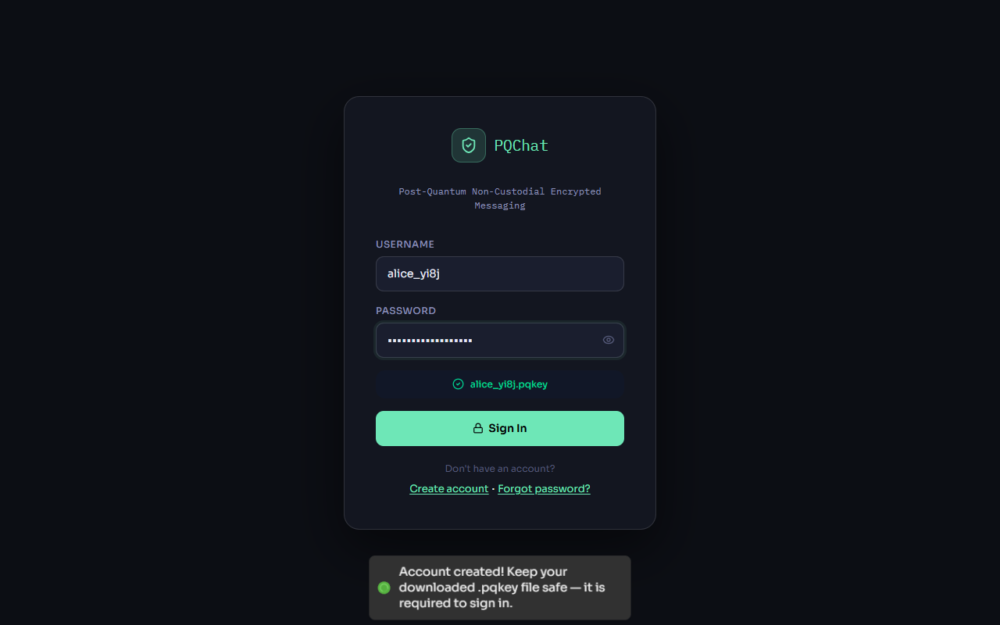
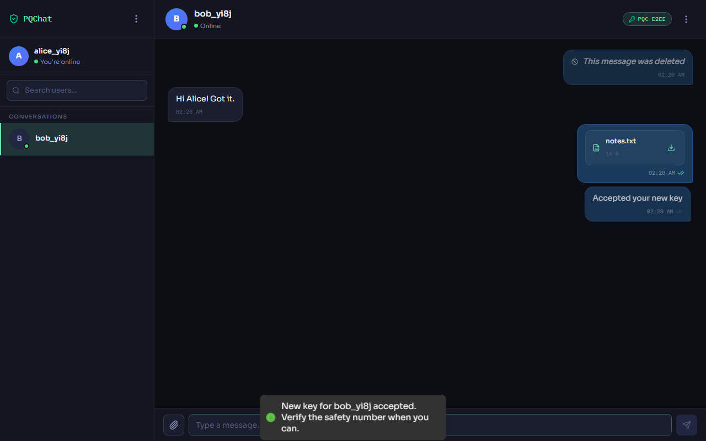
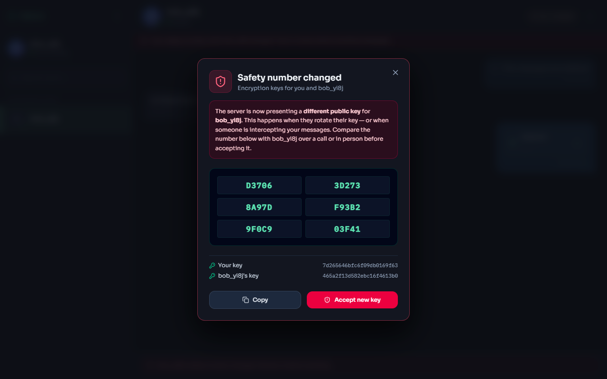
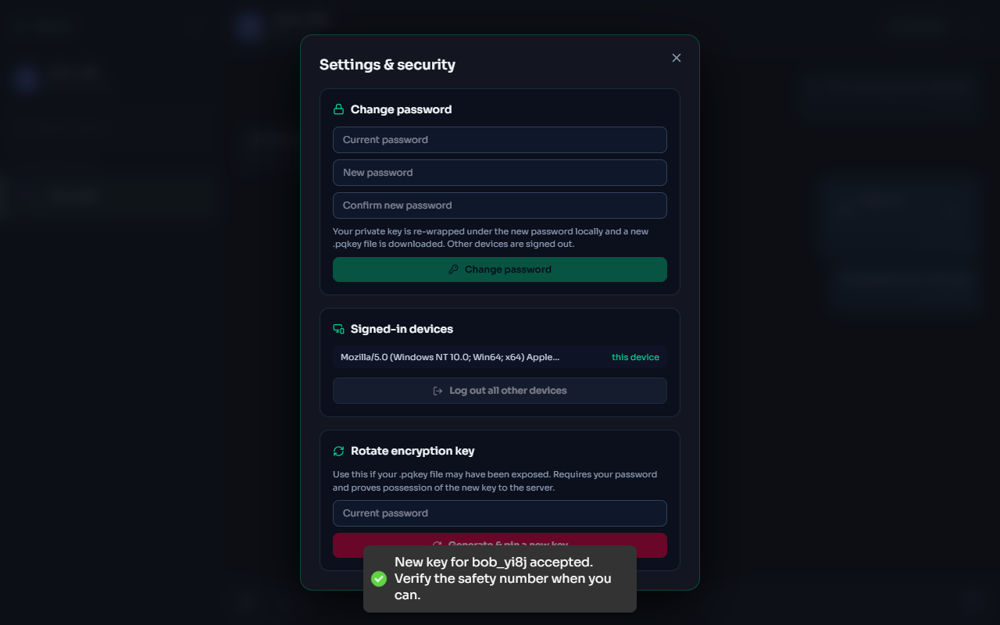

# 🔐 PQ-Chat: Post-Quantum End-to-End Encrypted Chat

[](https://github.com/Gulshan77350/PQ-Chat-post-quantum-secure-end-to-end-encrypted-chatting-app/actions/workflows/ci.yml)
[](LICENSE)
[](https://nextjs.org/)
[-blue)](https://csrc.nist.gov/pubs/fips/203/final)
[](https://socket.io/)

PQ-Chat is a real-time chat app where **all encryption happens in the browser**. It uses NIST's post-quantum key encapsulation standard, **ML-KEM (Kyber)**, combined with AES-256-GCM. The server stores only ciphertext and public keys. Logging in requires **both** your password and proof that you hold your private key, which is a challenge-response over ML-KEM. Peers' keys are pinned client-side (trust on first use), so a key swap by the server, or by anyone sitting in the middle, shows a "safety number changed" warning instead of passing silently.

Built with Next.js, Socket.IO, MongoDB and (optionally) Redis + S3-compatible storage. It runs as one process locally, or as N instances behind a load balancer.

---

## 📱 Screenshots

| Login (password + `.pqkey` file) | Encrypted chat (edit/delete, delivery status, files) |
| :---: | :---: |
|  |  |

| Key-change (TOFU) warning | Settings: password, devices, key rotation |
| :---: | :---: |
|  |  |

---

## ✨ Features

**Cryptography (client-side only)**
- ML-KEM-512 key encapsulation + AES-256-GCM (a hybrid KEM/DEM scheme). The parameter set is one constant (`ACTIVE_KEM`), and every ciphertext records which set it used.
- Each message's key is wrapped twice, once for the receiver and once for the sender, so both can read the history on any reload without the server ever holding a shared key.
- v2 message format: HKDF-SHA256 key derivation, with **AAD binding** the ciphertext to `(sender, receiver)`.
- File name and MIME type are encrypted *inside* the media blob. The server learns only the ciphertext size.
- Private key wrapped in a downloadable `.pqkey` file (PBKDF2-SHA256 with 600k iterations, then AES-GCM, with the username bound as AAD).
- 30-digit safety numbers, plus client-side **TOFU key pinning** that **blocks sending** after a peer's key changes until you review it.

**Authentication & sessions**
- Login = password **+ ML-KEM proof of private-key possession** (single-use challenge).
- Short-lived access JWT (15 min, kept in memory only) + rotating refresh token in an `httpOnly; SameSite=Strict` cookie.
- **Refresh-token reuse detection:** replaying a rotated-out token revokes the session.
- Server-side session revocation: logout, "log out all other devices", and password change take effect immediately, live sockets included.
- No username enumeration (decoy challenges, one generic error, constant-time password check).

**Messaging**
- Real-time over authenticated Socket.IO. Identity comes from the token, never from the client.
- **Sent → delivered → seen** receipts, edit (15-min window), delete-for-everyone (tombstones), clear chat.
- Cursor pagination on a stable compound `(createdAt, _id)` cursor.
- Multi-tab/multi-device presence, typing indicators.

**Platform**
- One shared API middleware layer: method dispatch → rate limit → DB → auth → errors.
- Rate limiting on a Redis sliding window, by IP **and** per account. Proxy-aware without trusting spoofed `X-Forwarded-For`.
- Encrypted media in **S3/R2/MinIO via presigned URLs**, with a local-disk fallback.
- Horizontal scaling: Socket.IO Redis adapter plus Redis-backed presence with heartbeats.
- Docker Compose stack (2 app replicas, nginx, Mongo, Redis, MinIO), GitHub Actions CI, and 40 automated tests.

---

## 🏗️ Architecture

```
 Browser A                               Server (N instances)                    Browser B
 ─────────                               ────────────────────                    ─────────
 ML-KEM keygen ── register(pubkey) ───▶  Users: pinned publicKey, keyVersion
 .pqkey download                         
                                         POST /auth/challenge
 decap(ct) → HMAC proof ◀── ct ───────── encap(pinned pubkey)
 password + proof ──────────────────────▶ verify → Session + JWT + refresh cookie

 GET /users/B ──────────────────────────▶ B's pinned key ──▶ compare to local TOFU pin
 AES-GCM(text, AAD=A:B)
 Kyber-wrap key for B and for A
 POST /messages (ciphertext) ───────────▶ MongoDB ──▶ Socket.IO room user:B ─────▶ decrypt
                                                       (Redis adapter fans out     │
                                         deliveredAt ◀── messages:delivered ───────┘
 ✓✓ seen ◀───── messages:seen ────────── seenAt ◀──── POST /messages/mark-seen

 encrypted file ──── presigned PUT ────▶ S3 / R2 / MinIO  ──── presigned GET ────▶ decrypt
```

`server.js` runs Next.js (pages + API routes) and Socket.IO on one HTTP server. API routes emit through a shared `io` instance, and with `REDIS_URL` set, room emits reach sockets on every instance.

---

## 🛡️ Security model

| Threat | Mitigation |
| --- | --- |
| Network attacker / DB leak | Only ciphertext + public keys stored; TLS in transit |
| "Harvest now, decrypt later" quantum adversary | ML-KEM key exchange; AES-256 (Grover → ~128-bit) |
| Stolen password | Login also needs the `.pqkey` private key (KEM proof of possession) |
| Server swaps a user's public key (MITM) | Keys only change via password + proof of possession; peers' clients pin keys and **block sending** on change; your own client warns if the server publishes a key that doesn't match your key file |
| Unauthenticated API / socket access | Every route goes through `apiRoute` (auth on by default); socket handshake verifies JWT + live session |
| Stolen refresh token | Rotation on every use + reuse detection revokes the session |
| Stolen access token | 15-min lifetime, memory-only, invalid as soon as its session is revoked |
| Brute force / credential stuffing | Per-IP **and** per-username limits in Redis; bcrypt (12 rounds) |
| Spoofed `X-Forwarded-For` | Ignored unless `TRUST_PROXY=n`; then the client is read *n* hops from the right |
| Ciphertext re-attributed to another conversation | AES-GCM AAD binds `(sender, receiver)` |
| Downgrade to legacy format | v2 messages have exactly one decryption path; legacy fallbacks apply only to pre-v2 rows and are flagged in the UI; the server rejects new legacy writes |

**Known limitations (deliberate scope):**
- **No forward secrecy.** Message keys are random per message but wrapped to each user's long-term ML-KEM key, so a leaked `.pqkey` + password decrypts that user's history. Getting there needs a ratchet with ephemeral keys (a post-quantum Double Ratchet / PQXDH-style handshake). Key rotation limits the damage going forward.
- **No sender signatures.** Anyone with a recipient's public key, the server included, can produce a ciphertext that decrypts. The server enforces who sent what, but the cryptography doesn't. The next step would be ML-DSA (FIPS 204) signatures.
- **Metadata is visible to the server:** who talks to whom, when, and message sizes.
- As with any web E2EE app, you trust the JavaScript the server delivers.

---

## 🚀 Getting started

**Prerequisites:** Node.js ≥ 20 and MongoDB (local, Atlas, or Docker).

```bash
git clone https://github.com/Gulshan77350/PQ-Chat-post-quantum-secure-end-to-end-encrypted-chatting-app.git
cd PQ-Chat-post-quantum-secure-end-to-end-encrypted-chatting-app
npm install
cp .env.example .env        # set MONGO_URI and JWT_SECRET
npm run dev                 # http://localhost:3000
```

Production: `npm run build && npm start`.

**Multi-instance stack** (2 replicas + nginx + Mongo + Redis + MinIO):

```bash
JWT_SECRET=$(openssl rand -hex 32) docker compose up --build
# open http://localhost:8080
```

### Configuration

| Variable | Purpose |
| --- | --- |
| `MONGO_URI`, `JWT_SECRET` | Required. The server refuses to start without them (`JWT_SECRET` ≥ 32 chars in production) |
| `ALLOWED_ORIGINS` | Socket.IO CORS allow-list |
| `TRUST_PROXY` | Number of reverse proxies in front of the app (default 0 = ignore `X-Forwarded-For`) |
| `REDIS_URL` | Enables the Socket.IO adapter, shared presence and shared rate limits |
| `S3_BUCKET`, `S3_ENDPOINT`, `S3_PUBLIC_ENDPOINT`, `S3_REGION`, `AWS_*` | S3-compatible media storage; otherwise `UPLOAD_DIR` on local disk |

---

## 🧪 Testing

```bash
npm test                                   # 40 tests: crypto, API integration, Redis stores
BASE_URL=http://localhost:3000 npm run smoke   # end-to-end against a running server
```

- `test/pqcrypto.test.js`: round trips for all ML-KEM parameter sets, AAD binding, the no-downgrade guarantee, legacy decryption, key files, KEM proofs.
- `test/api.test.js`: every protected route rejects anonymous and forged tokens; two-factor login; refresh-token reuse detection; log out other devices; key rotation needs password + proof; ownership checks on edit/delete; pagination; media access control. Runs against a real MongoDB via `mongodb-memory-server`.
- `test/redis.test.js`: multi-tab presence, crashed-instance expiry, sliding-window limiter.
- `scripts/smoke.mjs`: two real clients over HTTP + WebSocket, covering receipts, edits, media upload/download and logout socket-kick.

---

## 📡 API

All routes except register/challenge/login/refresh/logout require `Authorization: Bearer <accessToken>`.

| Method & path | Description |
| --- | --- |
| `POST /api/auth/register` | `{username, password, publicKey, kem}` |
| `POST /api/auth/challenge` | `{username}` → ML-KEM ciphertext encapsulated to the pinned key |
| `POST /api/auth/login` | `{username, password, challengeId, proof}` → access token + refresh cookie |
| `POST /api/auth/refresh` · `POST /api/auth/logout` | Rotate refresh token · revoke this session |
| `GET /api/auth/sessions` · `DELETE /api/auth/sessions` | List devices · log out all other devices |
| `POST /api/auth/change-password` · `GET /api/auth/me` | Change password (revokes other sessions) · own profile + pinned key |
| `POST /api/keys/challenge` · `PUT /api/keys` | Key rotation (password + proof of possession of the new key) |
| `GET /api/users?q=` · `GET /api/users/:username` | Search · a peer's pinned public key and key version |
| `GET /api/messages?with=&before=` · `POST /api/messages` | History (cursor pagination) · send |
| `PATCH /api/messages/:id` · `DELETE /api/messages/:id` | Edit · delete for everyone (sender only) |
| `GET /api/messages/recent` · `POST /api/messages/mark-seen` · `POST /api/messages/clear` | Conversations with unread counts · seen receipts · clear chat |
| `POST /api/media` · `PUT/GET /api/media/:id` | Reserve an upload (presigned URL or local) · local upload / authorized download |

**Socket events.** Server → client: `message:new`, `message:updated`, `messages:delivered`, `messages:seen`, `messages:cleared`, `presence:*`, `typing:*`, `key:changed`. Client → server: `typing:start|stop`, `messages:delivered`.

---

## 📁 Project structure

```
lib/
  pqcrypto.js      ML-KEM + AES-GCM + HKDF, key files, KEM proofs, safety numbers (browser + Node)
  api.js           apiRoute(): shared middleware (rate limit, DB, auth, errors), validators
  auth.js          JWTs, refresh-token sessions, rotation + reuse detection, revocation
  kemChallenge.js  server side of proof of possession
  socket.js        Socket.IO server: JWT handshake, Redis adapter, presence, receipts
  presence.js      in-memory / Redis presence with heartbeats
  rateLimit.js     sliding-window limiter (Redis / memory), proxy-aware client IP
  storage.js       S3 presigned URLs / local disk for encrypted media
  messages.js      serialisation, delivered/seen transitions
  session.js       browser: in-memory access token, single-flight refresh, apiFetch
  keyPinning.js    browser: TOFU pins
pages/api/         auth/, keys/, users/, messages/, media/
components/        ChatInput, MessageBubble, SafetyNumberModal, SettingsModal, UserList
test/              node:test suites
```

---

# 📚 Interview guide

### 30-second pitch
> "I built an end-to-end encrypted chat app where the server only ever sees ciphertext. Key exchange uses ML-KEM, the NIST post-quantum KEM, with AES-GCM for the payload, all in the browser. The interesting parts are around the crypto: login needs both the password and a challenge-response proving you hold your private key, sessions use rotating refresh tokens with reuse detection, and clients pin each other's keys, so if the server ever swaps a key the user gets a safety-number warning and sending is blocked. It scales horizontally with a Socket.IO Redis adapter, Redis-backed presence and rate limits, and media goes to S3 through presigned URLs."

### Likely questions

**Why encrypt with AES if you have Kyber?**
ML-KEM is a KEM: it establishes a 32-byte shared secret and can't encrypt arbitrary data. Each message gets a random master key. AES-GCM encrypts the content under an HKDF-derived key, and the master key is Kyber-wrapped once for the receiver and once for the sender. Wrapping it twice is what lets the sender read their own history after a reload without any server-held key.

**How does login prove key possession?**
The server runs `encap(pinnedPublicKey)` and stores a hash of `HMAC(sharedSecret, challengeId)` with a 2-minute TTL. The client decapsulates with its private key and returns the HMAC. Challenges are single use (consumed atomically with `findOneAndDelete`) and compared in constant time. ML-KEM's implicit rejection means a wrong key yields a random secret, so the proof simply fails.

**The server could just change Bob's public key. How do you stop that?**
Three layers. (1) The server only accepts a new key from an authenticated session that supplies the password *and* proves possession of the new key. (2) Alice's client pins the first key it saw for Bob and compares on every chat open and on `key:changed` events. A mismatch blocks sending until she reviews the safety number. (3) Bob's own client compares the key the server publishes for him with the one derived from his key file. A fully malicious server can still try, but it can't do it silently, which is the same model as Signal's safety numbers.

**Do you have forward secrecy?**
No, and the README says so. Keys are per message, but they're wrapped to long-term keys, so compromising a `.pqkey` exposes that user's past messages. Real FS needs ephemeral keys and a ratchet (Double Ratchet, or Signal's PQXDH for post-quantum). I'd add that next, along with ML-DSA signatures for sender authentication.

**How do refresh tokens work, and what happens if one is stolen?**
Each device gets a `Session` document that stores only the SHA-256 hash of the current refresh token and of the previous one. Every refresh rotates the token, using a conditional update so concurrent refreshes can't both win. If a *previous* token shows up again outside a 15-second grace window (which covers two tabs racing), that means two parties hold the token, so the session is revoked. Access tokens carry the session id, and every request checks that the session is still live, so revocation is immediate.

**How does it scale past one Node process?**
Socket.IO's Redis adapter fans `io.to(room).emit()` out across instances. Presence lives in Redis sorted sets of socket ids with expiry scores, refreshed by a per-instance heartbeat, so a crashed instance's users age out. Rate limits use a Redis sliding window. Auth state is in Mongo. Clients use WebSocket transport only, so the load balancer needs no sticky sessions. Media bypasses the app entirely through presigned URLs.

**Why is `X-Forwarded-For` dangerous for rate limiting?**
Clients can send any value, so trusting the header lets an attacker rotate fake IPs forever. Each proxy appends what it saw, so with `TRUST_PROXY=n` the real client is the *n*-th entry from the right. With no proxy configured, the header is ignored entirely.

**What were the hardest bugs?**
- Presence was stored in module scope, but Next bundles API routes separately from `server.js`, so API routes always saw an empty map. Fixed by sharing state through `globalThis` and Redis.
- A second tab overwrote the first tab's socket id, so closing either tab marked the user offline. Fixed with per-socket presence.
- History pagination used a timestamp-only cursor, which skips messages that share a millisecond. Fixed with a compound `(createdAt, _id)` cursor.

---

## 📜 License

MIT. See [LICENSE](LICENSE).
